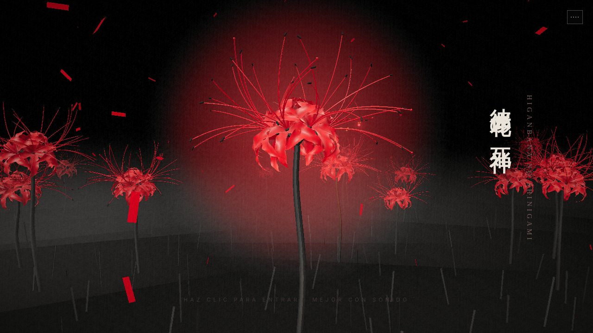
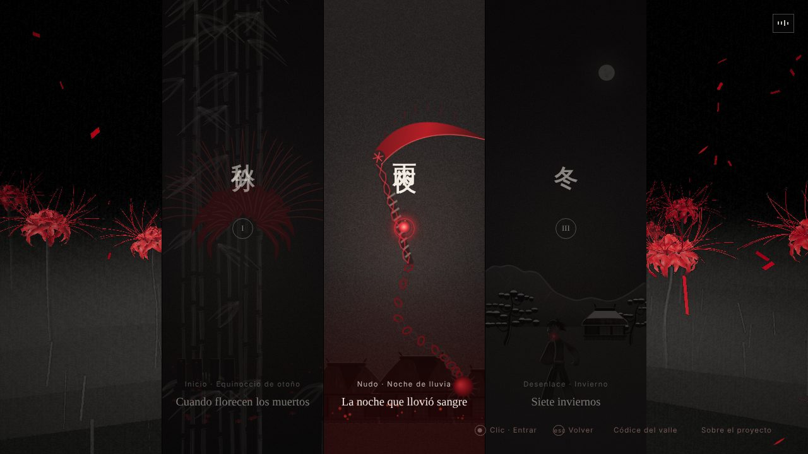
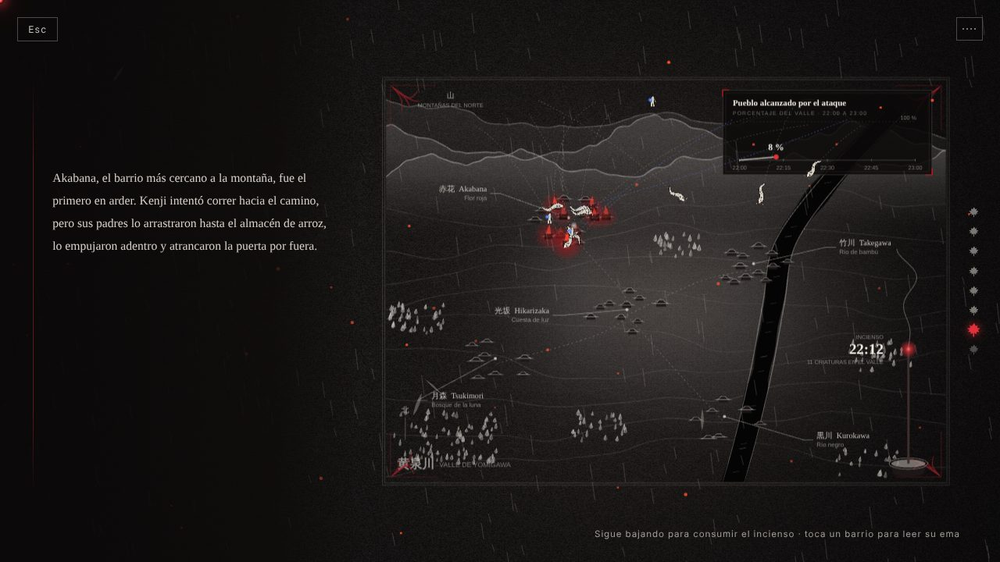
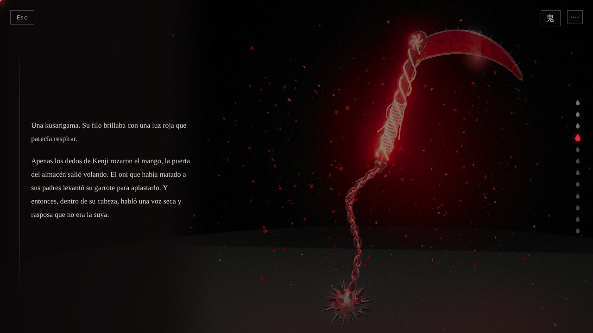
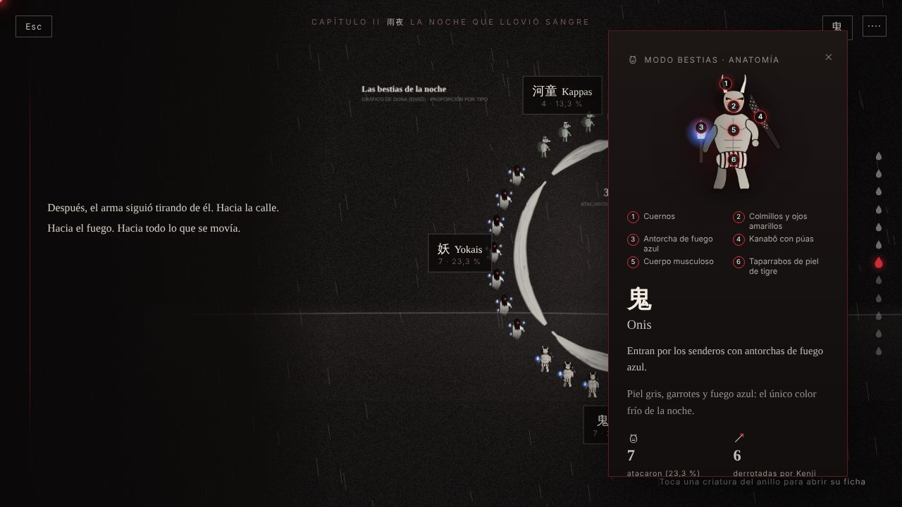
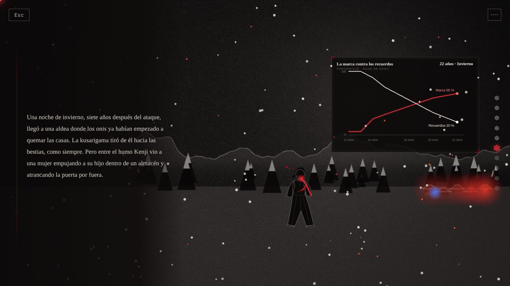
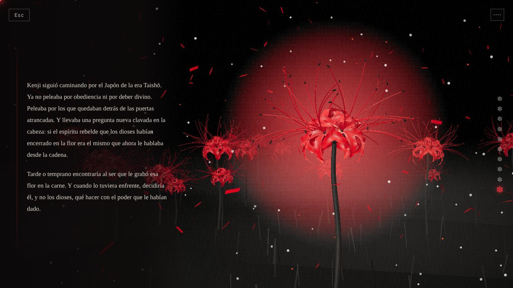

# 彼岸花の死神 · Higanbana no Shinigami

**Una historia interactiva en tinta y sangre.** Kenji, un muchacho del valle de Yomigawa, roza un lirio de araña y queda marcado por la flor de los muertos. Tres capítulos que mezclan lectura, ilustración en tinta, visualización de datos, 3D y música original, todo generado con código en el navegador.

**→ Ver en línea: https://armandomr99.github.io/Higanbana-No-Shinigami/** (mejor con sonido)



## Capítulos

| | Capítulo | Qué se vive |
| --- | --- | --- |
| I | **秋分 · Cuando florecen los muertos** | El bosque, la flor, la marca en el río, el ronin ciego y la noche del ataque sobre un mapa pintado del valle: un incienso marca la hora, los barrios arden, las criaturas bajan de las montañas y cada barrio guarda su *ema*. |
| II | **雨夜 · La noche que llovió sangre** | La marca despierta y la Kusarigama se forja pieza por pieza (mini juego en 3D). El latido del poder de Kenji, el ensō de las 30 bestias con sus fichas y el amanecer sobre las ruinas. |
| III | **冬 · Siete inviernos** | El recuento del valle (columnas de humo y 312 farolillos), el viaje en un emakimono que se desenrolla, la marca que crece contra los recuerdos que se borran y la redención: el lirio vuelve a formarse. |

## Galería

| | |
| --- | --- |
|  |  |
|  |  |
|  |  |

## La infografía: los cinco componentes

| Componente | Dónde vive en la historia |
| --- | --- |
| **Sistema iconográfico** | 31 íconos propios en una cuadrícula de 24 × 24 (`js/icons.js`), usados en mapas, fichas, gráficas, esquemas y en el códice. |
| **Esquemas** | Esquema de relaciones «Quién ata a quién» (Cap. III), secuencia de la forja (Cap. II), estructura en tres actos y cronología de la noche (códice). |
| **Gráficos estadísticos** | Líneas (incienso, latido, marca contra recuerdos), dona (ensō de las bestias), barras apiladas (criaturas al amanecer), barras sobre el mapa (destrucción) y gráfico de unidades (312 farolillos). |
| **Mapas** | Ubicación (Japón y el valle, con escala, norte y leyenda), mapa de calor de criaturas, símbolos proporcionales y la ruta del viaje en emakimono. |
| **Imágenes explicativas** | Ficha botánica del higanbana, la marca ampliada con lupa, la Kusarigama por piezas en 3D, anatomía numerada de cada bestia y el ronin con etiquetas. |

El **Códice del valle** (botón en el menú) reúne la estructura narrativa, el sistema de íconos, un índice con enlace directo a cada visualización y la bitácora del proceso.

## Proceso

| Fecha | Etapa |
| --- | --- |
| 7 y 18 ago 2026 | Historia, versiones 1 y 2, y biblia de datos |
| sep 2026 | Infografía *Kusarigama Radiata* |
| 20 sep 2026 | Prototipo interactivo en p5.js con seguimiento de manos |
| 14 oct 2026 | Planeación: arquitectura de información y bocetos |
| 28 oct 2026 | Boceto web (portada, menú, lectura por pasajes, 3D) |
| 8 nov 2026 | Etapa 2: escenas 2D, 3D solo para lo esencial, música por código |
| 9 nov 2026 | Pulido: navegación por pasos, lirio botánico, bloom, banda sonora |
| 11 nov 2026 | Versión final: íconos, esquemas, mapas con leyenda, barras apiladas, instrumentos grabados |

## Dirección de arte

- **Tinta y sangre:** todo en grises de tinta sobre papel carbón; solo el rojo del higanbana (y el azul del fuego de los onis) tiene color. Un postproceso de tinta lo aplica al 3D.
- **2D al estilo de la infografía *Kusarigama Radiata*:** trazos de pincel seco, aguadas, marcos finos, adornos rojos en las esquinas y etiquetas con líneas guía. Escenas en capas con paralaje suave.
- **3D solo para lo esencial:** el lirio de araña (portada y cierre) y la Kusarigama (forja y arma).
- **Datos como parte de la escena:** el reloj es una varilla de incienso, la destrucción la dibuja su humo, la dona es un ensō, las víctimas son farolillos que se apagan.

## Técnica

- **Three.js r169** (incluido en `vendor/`): lirio botánico paramétrico (tépalos ondulados, estambres, pistilo), Kusarigama con texturas de venas pintadas con código, reflejos de entorno (`RoomEnvironment`), *bloom* y un *shader* de tinta propio.
- **Canvas 2D:** librería de pincel propia (`js/two/brush.js`) para papel, trazos, montañas, bambú, personajes y criaturas; las capas se pintan una vez y las partes animadas usan *sprites* en caché.
- **Web Audio:** composición propia en escala miyako-bushi que se interpreta en el navegador con muestras de koto, shamisen, shakuhachi, cuerdas, coro, taiko y timbales; ambiente de lluvia, fuego y viento. El arreglo y el tempo cambian con cada pasaje.
- **Navegación por pasos:** rueda, gesto táctil o flechas avanzan un pasaje con una transición suave; las animaciones de los pasajes cortos se reproducen al llegar.
- **Calidad adaptativa:** si el equipo va lento, baja la resolución del 3D y el *bloom*. Respeta *prefers-reduced-motion* y recuerda la preferencia de sonido.
- Sitio estático, sin paso de compilación: se publica tal cual en GitHub Pages.

## Estructura

```
index.html            página única (carga, portada, menú, lectura, créditos)
css/style.css         estilos, paleta y tipografía
js/main.js            estados, qué acompaña a cada pasaje, transiciones, carga y calidad
js/story.js           texto de los capítulos y datos de las visualizaciones
js/reader.js          navegación por pasos
js/ui.js              ema de barrio y ficha de bestia (con anatomía)
js/icons.js           sistema iconográfico (SVG y lienzo)
js/codex.js           códice: estructura, íconos, índice de visualizaciones y proceso
js/audio.js           banda sonora y efectos
js/two/               escenas 2D: pincel, escenario, valle, escenas, partículas
js/scenes/            escenas 3D: el lirio y la forja
js/geo.js, js/ink.js  geometría 3D y postproceso de tinta
vendor/three/         Three.js r169 (licencia MIT)
assets/               ícono, imagen para compartir, capturas, muestras de audio y evidencias del proceso
```

## Probar en tu computador

Los módulos de JavaScript necesitan un servidor local:

```
python -m http.server 8000
```

y abre http://localhost:8000

## Créditos

Historia, dirección y diseño: **Armando (ArmandoMR99)**. Arte, música y datos originales; las ilustraciones, gráficas y mapas se dibujan con código.

- Three.js © sus autores, licencia MIT.
- Muestras de instrumentos: banco de sonidos **FluidR3_GM** de Frank Wen, licencia [CC BY 3.0](https://creativecommons.org/licenses/by/3.0/) (vía *midi-js-soundfonts*).
- Silueta de Japón: Natural Earth, dominio público (vía *world-atlas*).
